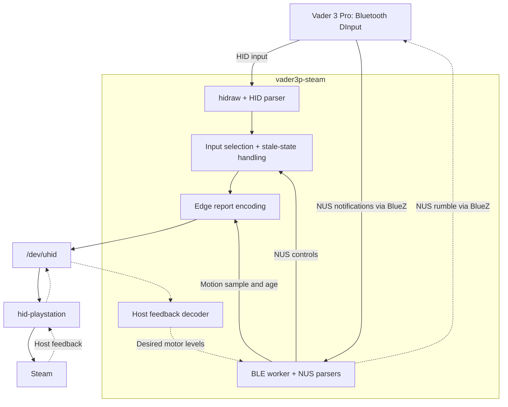
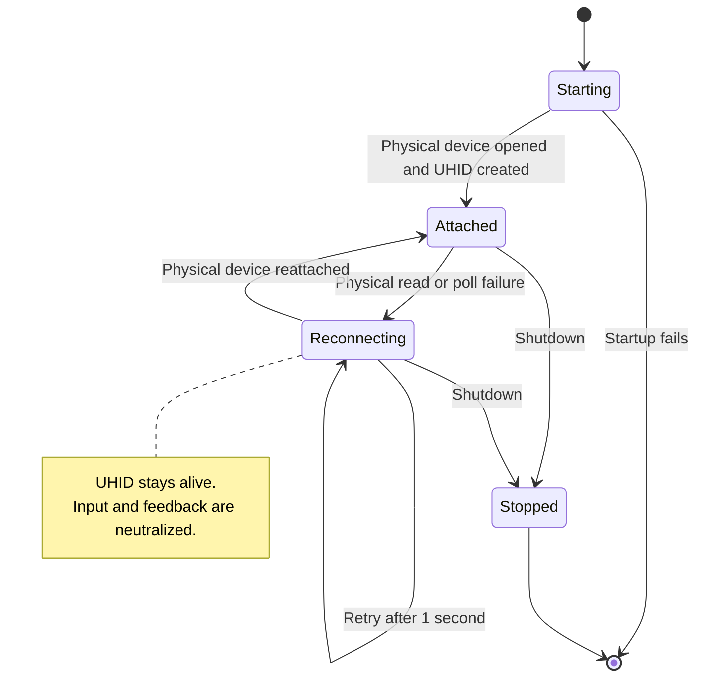

# Architecture

`vader3p-steam` translates a Bluetooth DInput Vader 3 Pro into one virtual
DualSense Edge. The physical transport is Bluetooth. The virtual device uses
Sony's USB report layout through Linux UHID so that `hid-playstation` can expose
its controls and motion sensors to Steam.

See the [README](README.md) for installation and
[VADER3P_PROTOCOL.md](VADER3P_PROTOCOL.md) for packet layouts.

## Data flow

UHID is the only backend. There is no physical USB or dongle backend, legacy
uinput device, or USB rumble fallback.

## Modules

| Source | Responsibility |
| --- | --- |
| [main.rs](driver/src/main.rs), [lib.rs](driver/src/lib.rs) | CLI, configuration, logging and shutdown signals |
| [config.rs](driver/src/config.rs) | TOML defaults, compatibility and validation |
| [device.rs](driver/src/device.rs) | Target discovery and nonblocking physical hidraw access |
| [suppress.rs](driver/src/suppress.rs) | Optional, reversible grabs on associated evdev nodes |
| [input.rs](driver/src/input.rs) | Ordinary Bluetooth HID input |
| [nus_input.rs](driver/src/nus_input.rs), [motion.rs](driver/src/motion.rs) | NUS controls and two packed motion components |
| [uhid_runtime.rs](driver/src/uhid_runtime.rs) | Main loop, input selection, stale state and reconnects |
| [edge.rs](driver/src/edge.rs), [edge_report.rs](driver/src/edge_report.rs) | UHID lifecycle, virtual reports and host feedback |
| [ble_worker.rs](driver/src/ble_worker.rs), [rumble.rs](driver/src/rumble.rs) | BlueZ sessions, motion activation and physical rumble |

## Discovery and startup

The controller must be connected before startup. Discovery accepts a hidraw
candidate on bus `0x05` with either the built-in `d7d7:0041` identity or the
recorded DInput descriptor. The observed `04b4:2412` device matches through its
descriptor. Descriptor matches take priority over ID-only matches.

Bus 5 does not establish the physical transport: a forwarded dongle can also
appear on that bus. Descriptor matching does not add dongle support.

The main thread opens the physical device, attempts any configured evdev grabs,
and creates the virtual pad. It starts a separate BLE worker when rumble or
motion is enabled. Blocking D-Bus calls stay off the main input loop.

## Input selection and timing

With motion disabled, the runtime reads ordinary 21-byte HID reports. With motion
enabled, HID remains the input source until a valid NUS sample arrives. NUS then
supplies controls and motion together.

Once NUS has supplied controls on a physical connection, stale or missing NUS
input becomes neutral. The runtime does not fall back to queued HID state, which
could retain an old button press. Reconnecting the physical device resets this
selection. Motion older than `motion.stale_ms` also becomes zero.

The main loop drains available physical reports and services host events. It
sends virtual reports on changed input and at a fixed 4 ms interval while UHID
is started. `poll_ms` does not control this interval. These intervals describe
scheduling, not measured end-to-end latency.

## Motion activation

Motion is opt-in. The worker subscribes to NUS TX and observes passively for
250 ms. If no qualifying data has arrived, it can attempt `AC 01` once per
connection generation, followed by a one-second observation window.

A qualifying data notification or selector response establishes an observation.
A write returning success does not establish activation. A D-Bus `NoReply` can
still be followed by data. If no qualifying observation arrives, activation is
marked `Unverified`.

The two raw components are uncalibrated. Axis selection runs before independent
X and Y inversion and signed 16-bit saturation. Defaults swap the components and
invert both: the second raw value supplies X/pitch, and the first supplies
Y/yaw. The third gyro component is zero. Acceleration and calibration values
presented to the virtual device are fabricated, not measured.

The daemon does not restore the selector on exit. If ordinary HID input is
absent after disabling motion, fully power-cycle and reconnect the controller.
That recovery cleared the stream in my recorded firmware 6.7.5.1 test. Restarting
Steam alone does not reset the selector. See the
[activation evidence](docs/evidence/uhid-emulation-2026-11-04.md).

## BlueZ trust boundary

The BLE worker discovers exactly one connected, resolved device matching the
configured Bluetooth address, plus its NUS RX and TX characteristics.

Before resolving `org.bluez`, the worker installs an authenticated name-owner
watch. It binds subscriptions and method calls to BlueZ's resolved unique bus
name. Notification callbacks check the actual sender, path, interface and
message type before parsing values. Broker matching alone is not sufficient
because directly addressed messages can bypass broker subscription rules.

Authenticated ownership changes invalidate the connection generation, samples
and desired feedback. Owner checks and bounded queue drains during setup prevent
an obsolete session from becoming active. Queue saturation fails closed.
Cleanup calls also target the old unique owner, never a replacement service.

## Feedback and lifecycle

Host output updates the desired motor levels. The BLE worker coalesces updates
instead of queueing every effect, checks the connection generation before
writing, and refreshes nonzero output every 100 ms. Physical rumble commands
expire after 200 ms unless refreshed.

Worker D-Bus calls have a 500 ms timeout. Polling uses 20 ms, link checks run
about once a second, and session retry backoff is 500 ms. Scheduling and blocking
calls can delay these intervals.

On a detected physical disconnect, the runtime invalidates input and feedback,
releases physical handles and grabs, and sends neutral state. The virtual UHID
pad remains alive. Reattach attempts run every second and reacquire the physical
handles and grabs.

Host CLOSE/STOP and shutdown request zero feedback. Cleanup attempts a physical
stop when its generation permits. Shutdown waits up to 1.2 seconds for the BLE
worker before detaching it. These are best-effort requests, not proof of motor
behavior. UHID is destroyed when the daemon exits.

Physical `EVIOCGRAB` blocks event delivery to other evdev readers. It does not
prevent device enumeration or hidraw access. Steam can still list the physical
controller. The [Steam visibility guide](docs/steam-controller-visibility.md)
describes a separate manual setting. The daemon never edits Steam configuration
or unbinds kernel drivers.

## Configuration reference

Create `~/.config/vader3p-steam/config.toml`, or pass `--config PATH`. The default
location respects `$XDG_CONFIG_HOME`; without it, `$HOME/.config` is used. If
neither variable exists, the base is `/etc`. Missing keys use defaults.

If the selected file does not exist, defaults are still validated. Defaults alone
require an address because rumble defaults to enabled. An unreadable or malformed
existing file is an error.

| Key | Default | Behavior |
| --- | --- | --- |
| `vendor_id` | `0xd7d7` | Compatibility metadata and diagnostic text; discovery uses built-in identities instead. |
| `product_id` | `0x0041` | Compatibility metadata and diagnostic text; does not change discovery. |
| `virtual_name` | `Flydigi Vader 3 Pro (UHID DualSense Edge)` | UHID name: 1–127 UTF-8 bytes, without NUL. |
| `rumble` | `true` | Forward host feedback over Bluetooth NUS. |
| `bluetooth_address` | unset | Six colon-separated hexadecimal octets; required when rumble or motion is enabled. |
| `poll_ms` | `4` | Compatibility-only value; has no effect on the UHID runtime. |
| `suppress_physical` | `true` | Attempt physical evdev grabs; failures produce warnings. |
| `log_level` | `info` | `error`, `warn`, `info`, `debug`, or `trace`, case-insensitive; unrecognized values use `info`. |
| `pad.backend` | `"uhid"` | Only accepted backend. Existing `[pad] backend = "uhid"` remains valid; explicit `uinput` is rejected. |
| `motion.enabled` | `false` | Enable experimental NUS input and motion. |
| `motion.scale` | `1` | Signed `i16` multiplier, nonzero when motion is enabled; output saturates to signed 16-bit. |
| `motion.stale_ms` | `100` | Freshness limit in milliseconds, 1–1000 inclusive, validated even when motion is disabled. |
| `motion.swap_xy` | `true` | Select the second raw value as X and the first as Y. |
| `motion.invert_x` | `true` | Invert X/pitch after axis selection, independently of yaw. |
| `motion.invert_y` | `true` | Invert Y/yaw after axis selection, independently of pitch. |

## Validation

The code implements these paths, but unit tests do not establish hardware
behavior. My earlier v4 tests and their artifact identity are recorded in the
[runtime evidence](docs/evidence/uhid-runtime-retest-2026-11-04.md). I have not
hardware-verified the cleaned build or its independent pitch correction.

The [testing guide](docs/TESTING.md) lists current acceptance gaps, including
calibration, physical rumble, repeated reconnects and latency.
