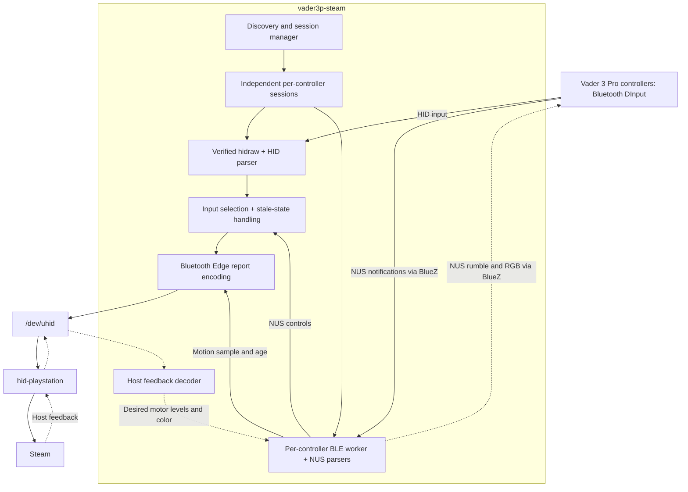

# Architecture

`vader3p-steam` discovers eligible connected Bluetooth DInput Vader 3 Pro
controllers and creates one independent virtual DualSense Edge for each. The
Bluetooth virtual device uses Sony's full Bluetooth report contract through
Linux UHID so that `hid-playstation` can expose its controls and motion sensors
to Steam.

See the [README](README.md) for installation and
[VADER3P_PROTOCOL.md](VADER3P_PROTOCOL.md) for packet layouts.

## Data flow

Each eligible physical controller has its own UHID pad and worker. UHID is the
only backend. There is no physical USB or dongle backend, legacy uinput device,
or USB rumble fallback.

## Modules

| Source | Responsibility |
| --- | --- |
| [main.rs](driver/src/main.rs), [lib.rs](driver/src/lib.rs) | CLI, configuration, logging and shutdown signals |
| [config.rs](driver/src/config.rs) | TOML defaults, compatibility and validation |
| [device.rs](driver/src/device.rs) | Target discovery and nonblocking physical hidraw access |
| [suppress.rs](driver/src/suppress.rs) | Optional, reversible grabs on associated evdev nodes |
| [input.rs](driver/src/input.rs) | Ordinary Bluetooth HID input |
| [nus_input.rs](driver/src/nus_input.rs), [motion.rs](driver/src/motion.rs) | NUS controls and two packed motion components |
| [uhid_runtime.rs](driver/src/uhid_runtime.rs), [uhid_runtime/fleet.rs](driver/src/uhid_runtime/fleet.rs), [uhid_runtime/session.rs](driver/src/uhid_runtime/session.rs) | Fleet discovery, independent session threads, input selection, stale state and teardown |
| [edge.rs](driver/src/edge.rs), [edge_report.rs](driver/src/edge_report.rs) | UHID lifecycle, virtual reports and host feedback |
| [ble_worker.rs](driver/src/ble_worker.rs), [rumble.rs](driver/src/rumble.rs) | BlueZ sessions, motion activation, physical rumble and RGB color |

## Discovery and startup

The manager scans for connected devices immediately and every second. It remains
running when no eligible controller is connected, so later connections are
discovered without restarting the daemon. Discovery accepts a hidraw candidate
on Bluetooth bus `0x05` with either the built-in `d7d7:0041` identity or the
recorded DInput descriptor. The observed `04b4:2412` device matches through its
descriptor.

Bus 5 does not establish the physical transport: a forwarded dongle can also
appear on that bus. Descriptor matching does not add dongle support.

The manager only scans, starts, signals and reaps sessions. Each controller
session runs its own input, virtual-pad and 4 ms reporting loop, attempts verified
evdev grabs, and starts a separate BLE worker when rumble, color or motion is enabled.
Basic input does not wait for a BlueZ lookup. Blocking D-Bus calls stay off the
manager and other controllers' input loops.
All sessions use the same rumble, color and motion settings; there are no per-controller
configuration overrides.
If a session's BLE worker cannot start, only that session is retired. It closes
its virtual pad on its own thread while holding its lease through the close;
other sessions continue.

For each candidate, the daemon verifies the full remote address from `HID_UNIQ`
against the opened hidraw device, its device number, inode, raw identity and
sysfs topology. It also verifies opened evdev identity before grabbing. It does
not fall back to `HID_PHYS` or the first candidate. Ambiguous identities are
skipped or retired only for the affected identity; incomplete scans do not imply
that healthy controllers were removed.

The virtual Bluetooth MAC is derived from all six physical address octets using
a domain-separated SHA-256 digest, then marked local and unicast. The same value
identifies that controller's UHID `uniq`, `phys` and reversed pairing feature
bytes. The truncated digest is not collision-free; detected collisions are
rejected.

Physical and virtual identity leases use `flock` files in the private
`$XDG_RUNTIME_DIR/vader3p-steam` directory, or `/run/user/<uid>/vader3p-steam`
when `XDG_RUNTIME_DIR` is unset. The runtime directory must be private and owned
by the effective user. The application directory is mode `0700` and lease files
are mode `0600`; symlink following is disabled. Lock files are never unlinked.
This excludes cooperating processes running as the same user, not legacy or
otherwise uncooperative daemons or processes running under another UID. Stop and
verify the old service during migration before starting the new daemon.

## Input selection and timing

With motion disabled, the runtime reads ordinary 21-byte HID reports. With motion
enabled, HID remains the input source until a valid NUS sample arrives. NUS then
supplies controls and motion together.

Once NUS has supplied controls on a physical connection, stale or missing NUS
input becomes neutral. The runtime does not fall back to queued HID state, which
could retain an old button press. Reconnecting the physical device resets this
selection. Motion older than `motion.stale_ms` also becomes zero.

Physical FN triggers one experimental pulse: PS alone for at least 100 ms,
PS + Cross for at least 60 ms, then PS alone for at least 40 ms, followed by
release. Each transition waits for a report; a short valid tap completes, while
invalid input or lifecycle cancellation stops the pulse. The host must be open
and started, and FN must be released before rearming. Synthetic controls are
OR-composed with physical Home and A; C, Z and M1–M4 retain their mappings.

The main loop drains available physical reports and services host events. It
sends virtual reports on changed input and at a fixed 4 ms interval while UHID
is started. `poll_ms` does not control this interval. These intervals describe
scheduling, not measured end-to-end latency.

## Motion activation

Motion is opt-in. The worker subscribes to NUS TX and observes passively for
250 ms. If no qualifying data has arrived, it can attempt `AC 01` once per
connection generation, followed by a one-second observation window.

A qualifying data notification or selector response establishes an observation.
A write returning success does not establish activation. A D-Bus `NoReply` can
still be followed by data. If no qualifying observation arrives, activation is
marked `Unverified`.

The two raw components are uncalibrated. Axis selection runs before independent
X and Y inversion and signed 16-bit saturation. Defaults swap the components and
invert both: the second raw value supplies X/pitch, and the first supplies
Y/yaw. The third gyro component is zero. Acceleration and calibration values
presented to the virtual device are fabricated, not measured.

The daemon does not restore the selector on exit. If ordinary HID input is
absent after disabling motion, fully power-cycle and reconnect the controller.
Restarting Steam alone does not reset the selector. A full power cycle and
reconnect cleared the stream in my test on firmware 6.7.5.1; other firmware may
behave differently.

## BlueZ trust boundary

Each session's BLE worker discovers exactly one connected, resolved BlueZ device
matching that session's verified physical address, plus its NUS RX and TX
characteristics. The optional `bluetooth_address` configuration value filters
which sessions the manager starts; it is not required for BLE operation.

Before resolving `org.bluez`, the worker installs an authenticated name-owner
watch. It binds subscriptions and method calls to BlueZ's resolved unique bus
name. Notification callbacks check the actual sender, path, interface and
message type before parsing values. Broker matching alone is not sufficient
because directly addressed messages can bypass broker subscription rules.

Authenticated ownership changes invalidate the connection generation, samples
and desired feedback. Owner checks and bounded queue drains during setup prevent
an obsolete session from becoming active. Queue saturation fails closed.
Cleanup calls also target the old unique owner, never a replacement service.

## Feedback and lifecycle

Host output updates the desired motor levels and, when enabled, RGB color.
The BLE worker coalesces color updates and sends at most one every 50 ms. Color
and rumble are independent, including when one host report contains both.
Color writes are not refreshed periodically, and pending colors are discarded
on host CLOSE/STOP or connection-generation changes. The daemon does not
restore the controller's previous lighting effect. A full power cycle restored
my controller's original button-pulse effect; other firmware might differ.
On my Legion Go, the physical LEDs followed Steam color changes in an attended
test. This does not establish every color, multi-controller behavior or other
firmware versions.

The BLE worker coalesces motor updates
instead of queueing every effect, checks the connection generation before
writing, and refreshes nonzero output every 100 ms. Physical rumble commands
expire after 200 ms unless refreshed.

Worker D-Bus calls have a 500 ms timeout. Polling uses 20 ms, link checks run
about once a second, and session retry backoff is 500 ms. Scheduling and blocking
calls can delay these intervals.

On source EOF, HUP, read failure, or confirmed removal in a complete scan, the
manager signals only that controller's session. The session requests zero
feedback, destroys its virtual pad on its own thread, and releases its physical
handles and grabs. A reconnect creates a fresh session with the same derived
virtual identity. Other sessions and the manager continue running. A requested
virtual-device removal is not proof that Steam refreshed its device list.

```mermaid
stateDiagram-v2
    [*] --> Starting
    Starting --> Attached: Physical device opened and UHID created
    Starting --> [*]: Startup fails
    Attached --> Retiring: Physical read failure or confirmed removal
    Retiring --> Removed: Pad destroyed on session thread
    Removed --> Attached: Manager discovers a reconnect; new session
    Attached --> Stopped: Shutdown
    Retiring --> Stopped: Shutdown
    Stopped --> [*]
    note right of Retiring
        Only this controller is retired.
        Its pad is destroyed on its session thread.
    end note
```

Host CLOSE/STOP and shutdown request zero feedback. Cleanup attempts a physical
stop when its generation permits. Global shutdown signals every session first,
then uses one 1.2-second grace period for all sessions and retiring workers.
These are best-effort requests, not proof of motor behavior. A retiring session
or BLE worker retains its identity lease until its actual cleanup ends.

Physical `EVIOCGRAB` blocks event delivery to other evdev readers. It does not
prevent device enumeration or hidraw access. Steam can still list the physical
controller. The [Steam visibility guide](docs/steam-controller-visibility.md)
describes a separate manual setting. The daemon never edits Steam configuration
or unbinds kernel drivers.

## Configuration reference

Create `~/.config/vader3p-steam/config.toml`, or pass `--config PATH`. The default
location respects `$XDG_CONFIG_HOME`; without it, `$HOME/.config` is used. If
neither variable exists, the base is `/etc`. Missing keys use defaults.

When you omit `--config`, the daemon reads the conventional file if it exists.
If that file is absent, the daemon validates and uses defaults. An explicit
`--config PATH` must name an existing file; a missing file is an error and does
not fall back to defaults. An unreadable or malformed existing file is also an
error. No address is required: an unset `bluetooth_address` selects all eligible
connected controllers. When set, `bluetooth_address` must be one canonical
six-octet Bluetooth address and restricts operation to that single controller,
regardless of whether rumble or motion is enabled.

A broken symlink at the conventional path is an error, not an absent file. Valid
symlinks load their target normally.

| Key | Default | Behavior |
| --- | --- | --- |
| `vendor_id` | `0xd7d7` | Compatibility metadata and diagnostic text; discovery uses built-in identities instead. |
| `product_id` | `0x0041` | Compatibility metadata and diagnostic text; does not change discovery. |
| `virtual_name` | `Flydigi Vader 3 Pro (UHID DualSense Edge)` | UHID name: 1–127 UTF-8 bytes, without NUL. |
| `rumble` | `true` | Forward host feedback over Bluetooth NUS. |
| `led` | `true` | Forward host lightbar colors over Bluetooth NUS. Set to `false` to prevent host color updates. |
| `bluetooth_address` | unset | Optional six-octet Bluetooth address filter; unset selects all eligible controllers, while a valid value selects one. Validated even when rumble and motion are disabled. |
| `poll_ms` | `4` | Compatibility-only value; has no effect on the UHID runtime. |
| `suppress_physical` | `true` | Attempt physical evdev grabs; failures produce warnings. |
| `log_level` | `info` | `error`, `warn`, `info`, `debug`, or `trace`, case-insensitive; unrecognized values use `info`. |
| `pad.backend` | `"uhid"` | Only accepted backend. Existing `[pad] backend = "uhid"` remains valid; explicit `uinput` is rejected. |
| `motion.enabled` | `false` | Enable experimental NUS input and motion. |
| `motion.scale` | `1` | Signed `i16` multiplier, nonzero when motion is enabled; output saturates to signed 16-bit. |
| `motion.stale_ms` | `100` | Freshness limit in milliseconds, 1–1000 inclusive, validated even when motion is disabled. |
| `motion.swap_xy` | `true` | Select the second raw value as X and the first as Y. |
| `motion.invert_x` | `true` | Invert X/pitch after axis selection, independently of yaw. |
| `motion.invert_y` | `true` | Invert Y/yaw after axis selection, independently of pitch. |

## Validation limits

Unit tests check software behavior but do not establish hardware behavior. A
targeted FN shortcut check does not establish full-build acceptance or verify the
independent pitch correction. The [testing guide](docs/TESTING.md) describes the
checks available to contributors.
